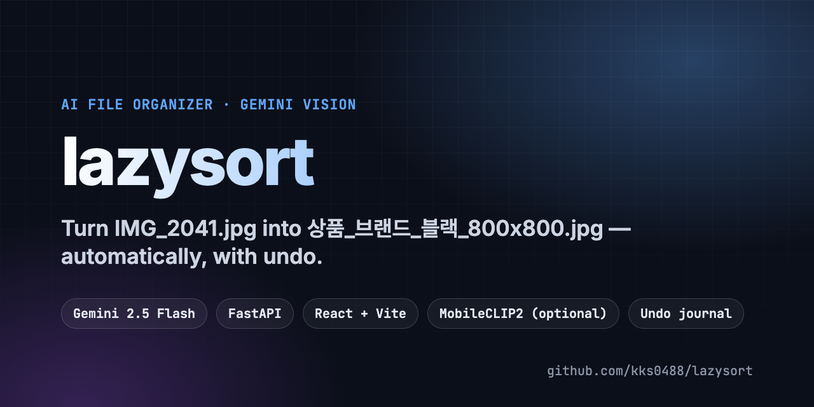
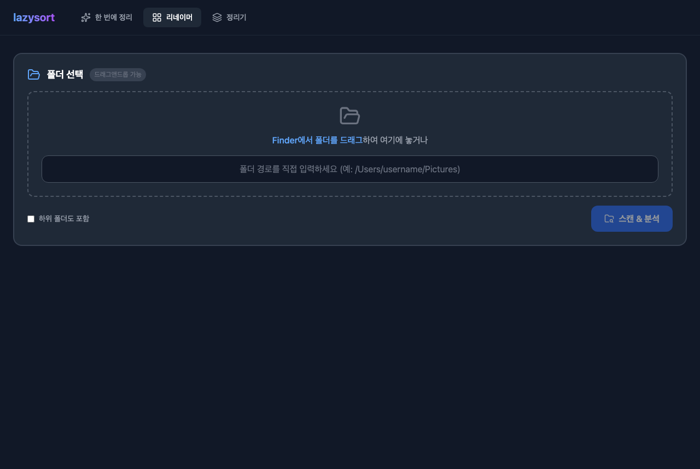

<p align="center">
  
</p>

<p align="center">
  <a href="README.md"><b>English</b></a> · <b>한국어</b>
</p>

<p align="center">
  <a href="LICENSE"></a>
  
  
  
</p>

<h2 align="center"><code>IMG_2041.jpg</code>, <code>최종(2).png</code>로 가득한 폴더?<br>lazysort가 이미지를 보고 검색되는 이름을 붙여 줍니다.</h2>

<p align="center">
  디자이너·쇼핑몰 팀을 위한 로컬 웹앱입니다.<br>
  Gemini 비전이 이미지를 읽고 이름을 제안하며, 모든 이동은 되돌릴 수 있습니다.
</p>

<table>
<tr>
<td width="50%" valign="top">

### 내용을 보고 이름 짓기
Gemini 2.5 Flash가 이미지를 상품·배너·스크린샷·문서·라벨·사진으로 나누고 브랜드와 태그를 붙입니다. 새 이름은 `분류_브랜드_태그_해상도.확장자`.

</td>
<td width="50%" valign="top">

### 이미 적어 둔 단서는 유지
기존 파일명의 단어(브랜드·시즌·색상)를 읽어 AI 태그와 합칩니다.

</td>
</tr>
<tr>
<td width="50%" valign="top">

### 정리 전 청소
MD5 중복 찾기, 저해상도·스크린샷 표시, 비슷한 이미지 묶기(Gemini 이미지 설명 → 임베딩 → DBSCAN, 묶음 이름은 AI가 지음).

</td>
<td width="50%" valign="top">

### 안전 장치
이름 변경은 기록 파일에, 이동은 실행 전에 저널에 먼저 저장되어 마지막 작업을 되돌릴 수 있습니다. 실행 전 모든 제안을 미리 봅니다.

</td>
</tr>
</table>

<p align="center">
  
</p>

## 정리 방식 3가지

| 탭 | 하는 일 |
| --- | --- |
| **리네이머** | 폴더 스캔 → AI 이름 미리보기 → 한 번에 적용 → 되돌리기 |
| **정리기** | 중복·저해상도 찾기, 비슷한 이미지 묶기, 이동 후 롤백 |
| **한 번에 정리** | 작업 시간 간격으로 묶고, 맥 Vision OCR로 브랜드명 읽기, 선택적으로 MobileCLIP2 분류 |

## 빠른 시작

```bash
git clone https://github.com/kks0488/lazysort.git
cd lazysort/backend
python3 -m venv .venv && source .venv/bin/activate
pip install -r requirements.txt
export GEMINI_API_KEY="발급받은 키"
python main.py                 # http://127.0.0.1:2424

cd ../frontend && npm install && npm run dev
```

로컬 모델(MobileCLIP2, 맥 Vision OCR)은 선택: `pip install -r requirements-local-models.txt`

## 자주 묻는 질문

**파일이 어디로 올라가나요?** 분석을 위해 이미지 내용이 Gemini API로 전송됩니다. 파일 자체와 이름 변경·이동은 내 컴퓨터에서만 일어납니다.

**되돌릴 수 있나요?** 네. 앱의 되돌리기/롤백 버튼을 쓰세요.

**완성도는?** 실제 쇼핑몰 자료 폴더를 정리하려고 만든 동작하는 시제품입니다. 기본은 내 컴퓨터(localhost)에서만 열립니다.

## 라이선스

MIT © Kyoungsoo Kim — [LICENSE](LICENSE).
